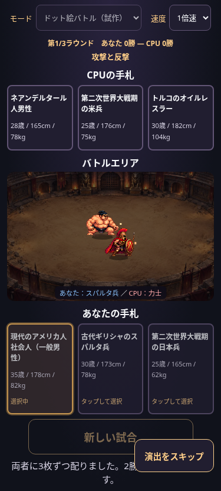

# 待機PNGによる表示検証

最新の画像登録設定は [ID別スプライト登録表](sprite-registry.md) を参照してください。以下の固定配役・設定位置は当時の実装記録です。

現在のドット絵モードは[横視点演出](side-view-battle.md)に更新されています。以下は以前の試作の記録です。

`assets/characters/spartan_idle.png` と `sumo_idle.png` は添付された192×192pxの透過PNGをそのまま保存しています。あなた側にスパルタ兵、CPU側に力士を固定表示します。配布カードのID・能力値との対応はなく、今回の仮配置は見た目の検証専用です。

## 調整場所

`js/pixel-battle.js` の `SPRITES` に画像URL・描画高さ・透過余白を除いた矩形をまとめています。

| 側 | 高さ（Canvas座標） | 描画元の矩形 x/y/幅/高さ |
| --- | --- | --- |
| あなた：スパルタ兵 | 46 | 22 / 45 / 147 / 139 |
| CPU：力士 | 42 | 25 / 75 / 142 / 109 |

高さを変更すると幅も同じ比率で変更されます。足元は矩形の下辺中央を既存の移動座標に固定し、影も同じ座標に置きます。歩行時の上下揺れは画像に加えていません。CPUの画像は左右反転しています。Canvasの `imageSmoothingEnabled=false` と既存の `image-rendering:pixelated` で輪郭を保ちます。

将来は `poses.walk` や `poses.attack` に `[[x,y,w,h], ...]` のコマを追加できます。未設定の動作では同じ待機矩形を使います。コマの下辺中央を同じ足元基準に合わせてください。

現在は同じ待機PNGで移動・攻撃・被弾を表現し、小さな光で攻撃・被弾・勝利を補います。敗者の転倒とWIN表示、既存のタイムライン・速度・スキップは維持しています。読み込みを待ってから演出の時計を開始します。画像読み込みに失敗した場合は旧仮キャラを使い、進行を止めません。

## 検証

- 375 / 390 / 430 / 1280pxでドット絵モードとカードモードを検証。
- 実PNGの表示を375pxとPCで目視確認。装備・体格、影と足元、画像の収まりを確認。
- 単体テストで縦横比・足元基準・平滑化無効・全2002時点の転倒を含む画像四隅の収まりを確認。
- 既存の勝敗・先攻後攻・3ラウンド・ストーリー保存・乱数呼出回数一致のテストを実行。
- ブラウザ検証では環境のネットワーク制限に合わせ、実PNGをテスト時だけdata URL化しています。製品は相対パスで読み込みます。実機Safariと公開GitHub Pages配信は未確認です。

[PC表示](screenshots/character-sprites-1280.png)
