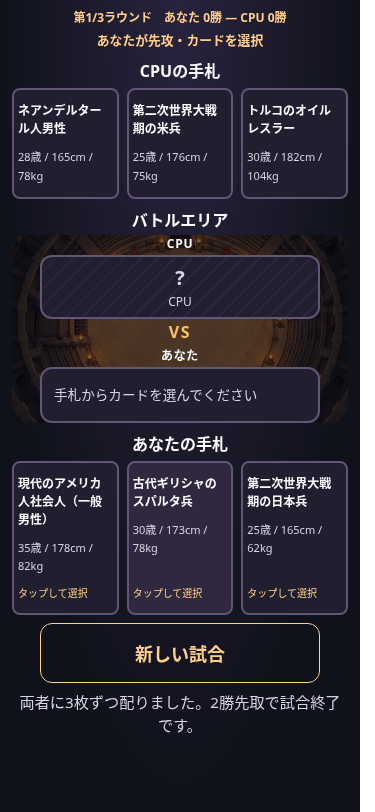

# コロシアム背景

## 導入画像

ユーザー添付の `1174.jpg`（JPEG、1280×720px、117,159バイト）を、`assets/backgrounds/colosseum.webp` に変換して導入しました。WebP品質85、元の解像度・構図を保持し、111,472バイト（約109KiB、元画像から4.9%削減）です。代替画像や生成画像は使用していません。

## 背景の設定と差し替え

`index.html` 冒頭のCSS変数で画像・位置・暗幕をまとめて設定します。

```css
--arena-background-image: url('./assets/backgrounds/colosseum.webp');
--arena-background-position: 50% 50%;
--arena-background-overlay: rgb(10 9 15 / 60%);
```

画像はHTMLを基準とする相対パスで読み込みます。先頭にスラッシュを付けないため、GitHub Pagesの `/HumanityStrongest/` 配下でも参照できます。CSSを別ファイルに移す場合は、そのCSSファイルからの相対パスに直してください。

背景を差し替える場合は同じパスの画像を置き換えるか、URLだけを変更します。中央がずれた画像では `--arena-background-position` を調整します。画像を使わない場合は `--arena-background-image: none` に戻せます。

大きな差し替え画像は縦横比を保ち、長辺1600〜2000px程度のWebP・品質80〜85を出発点として、石壁や照明の見た目を原画像と比較します。目安は500KB以下ですが、既に小さな画像を拡大する必要はありません。

## 配置と可読性

中央の `.battle-arena` の背面に、背景画像と60%の暗幕を重ねています。`background-size: cover` で縦横比を保って領域を覆い、闘技場の中心は中央に配置します。画面の比率によって外周の一部が切れますが、選択カードは既存の大きさを保ちます。カードの不透明な背景色も維持し、名前やプロフィールを読みやすくしています。

背景は通常のページと一緒にスクロールし、カードとの相対的な位置を保ちます。`fixed` や `sticky` は使いません。リザルトと物語は `.battle-arena` の外にあるため、その表示の長さでは背景が引き伸ばされません。使用済みラベルや選択カードによって既存UIの高さが変わる際は、背景もバトルエリアに追従します。

背景はレイアウト寸法を持たずクリックも受け取りません。カード・炎・フラッシュの背面に置き、既存の衝突時の微振動は維持しています。手札・結果・タイトルの背景、ゲームのJavaScript・データ・操作フローには変更を加えていません。

## 検証

- `node tests/background.browser.cjs`：375/390/430/1280pxで、実WebPのデコード（1280×720px）・相対URL解決・暗幕・背景のレイヤー・スクロール追従・結果表示後の位置を確認。手札各3枚、プロフィール、長い名前、横はみ出しも確認します。
- `WIDTHS=375,390,430,1280 node tests/mobile.browser.cjs`：実背景の下で両先攻、カード移動・衝突・燃焼・WIN・連打防止・3ラウンド・保存済み結果を確認します。
- `WIDTHS=375,1280 REDUCED_MOTION=1 node tests/mobile.browser.cjs`：短縮演出とゲーム進行を確認します。

ブラウザのネットワークアクセスには実行環境の制限があるため、Chromium検証では実ファイルの画像・スクリプトをインライン化しています。製品では通常の相対URLを使います。実機Safari・公開GitHub Pages配信の確認は含みません。

375pxの表示例（背景を有効化した初期状態）：


