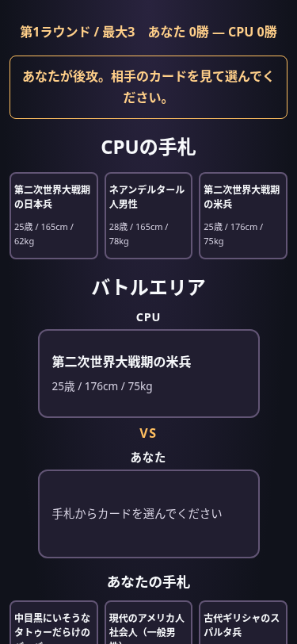
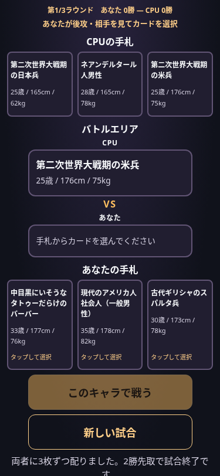

# スマートフォンUIの比較

同じ6人の手札・CPU先攻・375×812pxを、ページ先頭から比較しています。画像は読みやすさの比較のためreduced-motionで撮影しました。通常アニメーションは別途ブラウザテストで確認しています。

| 画面幅 | 修正前のプレイヤー手札下端 | 修正後 | 短縮 |
| --- | ---: | ---: | ---: |
| 375px | 912px | 631px | 281px |
| 390px | 885px | 605px | 280px |
| 430px | 893px | 614px | 279px |
| 1280px | 922px | 868px | 54px |

CPUとプレイヤーの手札はどちらも3枚横一列のままです。手札カードのフォント・内側余白・幅・高さは変更していません。同じ375pxの手札ではCPUカード高さ106px、プレイヤーカード高さ150pxで、変更前後が一致しています（枠線を除く）。長い名前は折り返し、カードは内容に応じて伸びます。高さの低い端末や文字拡大時はスクロールを許し、読みやすさを優先します。

主な変更はラウンド/勝数の1行化、先攻後攻の案内枠の廃止、中央見出し・VS・ラベルの余白削減、未選択枠の最小高さ削減です。選択済みの中央カードは可変高さのままにし、名前やプロフィールを切り取りません。

## 修正前

## 修正後

## 検証

通常設定の320/375/390/430/768/1280pxで、両者の手札3枚・横並び・プロフィール・横はみ出しなし、先攻後攻、CPU公開タイミング、150ms/400msの移動、連打防止、3ラウンド進行/2勝終了、既存リザルトを検証します。375/390/430pxでは初期表示の手札下端が812px以内、プレイヤーカードの高さが56px以上であることも確認しています。

ブラウザ検証はローカル実ファイルのChromiumで、実機Safariや公開GitHub Pagesの配信確認は含みません。ゲームルール・データ・文章生成・移動処理は変更していません。
