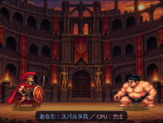
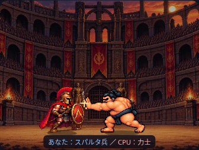
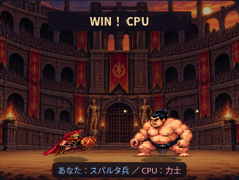

# 攻撃後に向きが戻る不具合の根本修正

## 根本原因

PR #35の共通の相対向き計算はmainに反映されていました。しかし素材の元向きの指定が誤っていました。

| 素材 | 実際の元向き |
| --- | --- |
| スパルタ兵 idle / walk / thrust | 右 |
| 力士 idle | **左** |
| 力士 walk / slap | 右 |

力士は待機画像だけが左向きです。以前は全素材を右向きと指定していたため、右側の力士が攻撃・歩行シートからidle画像へ戻ると、左向き画像が反転されて右を向いていました。勝利・被弾もidleを使うので同じ誤りが発生しました。

前回のテストも全素材が右向きという前提で反転フラグを検査しており、誤った指定を検出できていませんでした。

## 描画処理の修正

- 力士の基本画像は `sourceFacing=-1`、歩行・張り手はクリップごとに `sourceFacing=1` を設定。
- 相手との位置で決める向きと、選択された画像の元向きを `spriteOrientation` で比較。
- 水平反転の適用とdrawImageを共通の `drawOrientedImage` に集約。足元へtranslateした同じ支点で反転し、状態固有の反転は追加しません。
- 前進・後退やアニメーションの種類でゲーム上の向きは上書きしません。
- サイズ、素材、移動、時間、ルール、背景、UIは維持しています。HTMLはキャッシュバージョンのみ変更。

## 回帰テスト

実画像を目視確認した元向きを、ハッシュ付きの独立したfixtureに記録しました。表示の判定は **画像の既知の元向き × drawImage時の実Canvas変換の左右符号** を使い、ゲーム側のsourceFacingやflipを正解として使い回しません。

- 同じ回帰テストが修正前mainで `sumo_idle.png: 1 !== -1` と失敗し、修正後に成功することを確認。
- facing.browser.cjs：375/390/430/1280pxで各23,070描画、合計92,280描画。両キャラの左右配置・1/2倍速・3ラウンド相当の全状態を連続検証。攻撃開始・終了などの境界前後1msも追加し、素材6枚をすべて使用。
- pixel.browser.cjs：実時間再生の各drawImageも同じ独立fixtureで監視。全4幅の両先攻・最大3ラウンド・速度変更・スキップと保存結果を検証。
- 反転前後の足元の一致、同座標の保持、左向き素材属性、攻撃方向とヒット光のテストも維持。
- カードモード、力士の張り手、スパルタ兵の足元、勝率・勝敗・文章・CSVの既存テストも成功。

## 確認画像（375px・描画検証フレーム）

待機：

張り手：

勝利後のidle画像：

確認はChromiumです。左右を入れ替えるケースは検証用の座標を使用しています。ネットワーク制限のためテストでは実画像をインライン化しています。実機Safari・公開Pagesは未確認です。
