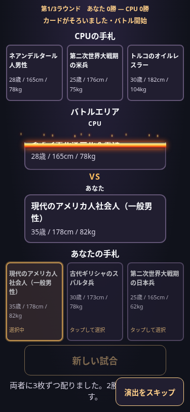
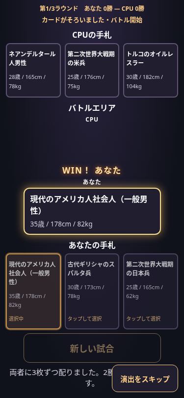

# 1タップ操作とバトル演出

現在の配布・試合進行・連勝記録は [単発対戦の仕様](single-match.md) を参照してください。以下の3枚制・複数ラウンドの説明は以前の記録です。

カードを1回タップすると確定し、選び直し用の確定・開始ボタンは表示しません。CPU先攻は公開カードの配置完了後にあなたが選択。あなた先攻は先にあなたのカードを配置し、その後に既存のCPUランダム選択を呼んでCPUも配置します。

## 演出の順序

1. 手札から中央への移動：浮き上がり150ms＋移動400ms。
2. 両カードがそろったら勝敗・物語を一度だけ確定し、画面にはまだ結果を表示しない。
3. 220ms対峙→220msで中央へ突進→140msのフラッシュと180msの小さな振動→180msで元の位置へ。
4. 敗者のカードだけを1000msで燃焼。clip-pathの上辺を0%→100%へ進めるため、燃えた上側から消える。オレンジ・赤の境界と10個の小さな粒子は別レイヤーで追従する。
5. 勝者は消さず発光し、中央のVS位置に「WIN！ あなた」または「WIN！ CPU」を450ms表示。その後に保存済みの既存リザルトを表示。

火の粉の位置・動きに乱数は使いません。演出は確定結果を受け取るだけで、命中や勝敗を再計算しません。キャラクター画像・外部ライブラリは使用していません。

## 停止や二重操作への対応

- 配置開始時に操作をロック。連打・直接イベントでもカード選択やラウンド解決を重複させない。
- 「演出をスキップ」またはEscで待機とアニメーションを解除し、同じ結果へ進む。
- reduced-motion/API未対応では動きを省略。実行中の設定変更やページ非表示でも待機を解除する。
- 各アニメーションには完了待ちのタイムアウトも用意。
- 自動スクロールを行わず、演出中はページスクロールをロック。終了後に戻す。
- 次のラウンド・新しい試合ではマスク、炎、WIN、勝者の強調をリセット。

## 動作確認画像（375px）

燃焼途中。CPU側の上部が透明になり、境界より下にはプロフィールが残っています。

勝者だけを残したWIN表示。リザルト表と物語はこの後に表示します。

## 検証

375/390/430/1280pxと320/768pxで、両先攻の1タップ・3ラウンド決着・2連勝終了・連打防止・敗者だけの燃焼・燃焼境界の進行・WIN/実際の勝者一致・既存結果/6能力比較/勝率/物語との一致を確認します。結果が燃焼・WINより先に出ないこと、演出中のscrollYが変わらないことも検証します。

375/1280pxのreduced-motionではアニメーション呼び出し0回と同じ進行を検証。スキップとvisibilitychange経由でも結果が保存され、次のラウンドへ進めることを確認します。非表示の検証はブラウザ内でhidden状態とイベントを再現しています。

ブラウザ確認はローカル実ファイルのChromiumです。実機Safariや公開GitHub Pages配信での確認は含みません。
