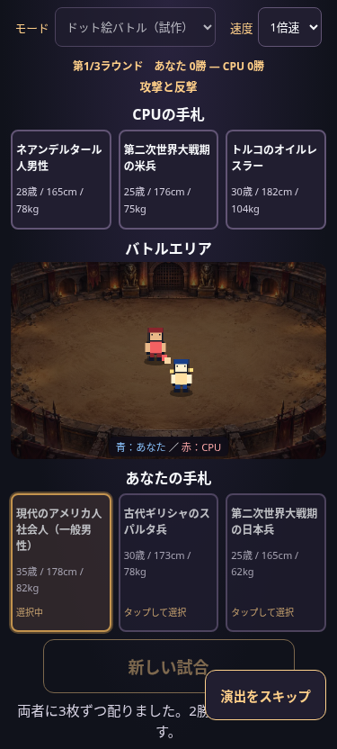
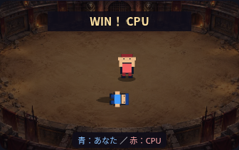

# ドット絵バトル（試作）

## 遊び方

画面上部の「モード」で「カードバトル」「ドット絵バトル（試作）」を切り替えます。初期値はカードバトルです。カード選択前やラウンド終了後に切り替えられます。配置・戦闘中はモードの変更をロックします。

どちらのモードも、同じ3枚の手札・先攻後攻の順序でカードを1回タップして進行します。CPU先攻の選択カードは先に確認できます。ドット絵モードでも、選択カードがそろうまでは既存のカード移動演出を使用します。

ドット絵モードの戦闘開始時に中央の大きなカードを隠し、CPUを上側の赤、あなたを下側の青で表示します。「速度」は途中でも変更可能です。1倍速は約10秒、2倍速は約5秒（カード配置時間を除く）。「演出をスキップ」やEscで、同じ保存済み結果へ進みます。

## 演出と判定の分離

`js/pixel-battle.js` は320×200の透明Canvasに16×24pxの仮キャラを描きます。外部ライブラリやキャラクター画像は使用しません。背景は既存の `assets/backgrounds/colosseum.webp` と暗幕を使用します。

時間に沿って待機→接近→攻撃・反撃→横への回り込み→後退→再接近→最後の攻撃→敗者の転倒→勝者のポーズ・WIN表示と進みます。足元の影を付け、砂地の内側で動かします。描画ごとに背景を描き直したりスクロールしたりする処理はありません。

既存の `HumanityMatch.playRound` で勝敗とストーリーを一度だけ確定し、その後で結果の `winner` を演出へ渡します。描画モジュールは能力値・勝率・勝敗判定・ストーリー生成を参照せず、乱数も使用しません。勝者によって最後に攻撃する側・倒れる側・WIN表示を選びます。

ゲーム進行の `match.js`、勝敗計算の `battle.js`、正式30人データ、戦闘スタイル、ストーリー生成は変更していません。使用済みカードや2勝先取も共通です。リザルトは既存の表・勝率・保存済みストーリーをそのまま表示します。結果表示後のモード切り替えも再判定・再生成を行いません。

## 時間と終了処理

- `requestAnimationFrame` の経過ミリ秒×現在の速度で進行し、フレーム数に依存させません。
- 速度変更時には変更直前までを旧速度で積算してから切り替えます。途中から遡って速度を掛けることはありません。
- スキップ・ページ非表示・reduced-motionへの変更は既存の演出終了処理から同じ最終フレームへ進みます。reduced-motionでは戦闘を短縮します。
- rAF停止時にも期限タイマーで終了できます。終了時はrAFとタイマーを解除します。
- Canvasが使えない場合もゲーム進行を止めず、既存のリザルトへ進みます。

## 表示例

375px、攻撃と反撃の途中。手札を残し、中央だけをCanvasへ切り替えています。



勝利ポーズと敗者の転倒。この例では赤のCPUが勝利しています。



[PC表示（1280px）](screenshots/pixel-exchange-1280.png)

## 検証コマンド

```sh
node tests/pixel-battle.test.cjs
node tests/pixel.browser.cjs
WIDTHS=375,390,430,1280 node tests/mobile.browser.cjs
node tests/background.browser.cjs
```

単体テストでは両勝者の2002時点を調べ、砂地内の位置・攻撃距離・6つのポーズ・敗者だけの転倒・乱数消費ゼロを検証します。仮想時計で1倍10秒・2倍5秒・1→2→1の変更・遅延フレーム・期限タイマー・二重スキップ・Canvas未対応を確認します。

ブラウザでは375/390/430/1280pxで両先攻と3ラウンドを確認し、実時間での速度・途中変更・連打防止・スキップ・非表示時の終了・モード切り替え・既存リザルトとの一致を検証します。同じ乱数列でカード/ドット絵モードを再生し、全ラウンドのカード・勝率・勝敗・ストーリー・乱数呼出回数が一致することも確認します。

ブラウザ確認はChromiumで、ネットワーク制限のため実ファイルをインライン化しています。実機Safari・公開GitHub Pages配信の確認は含みません。

## 試作の範囲

青と赤の共通グラフィックによる攻防演出です。個別グラフィック・固有技の可視化、移動AIや当たり判定は今後の開発対象です。
