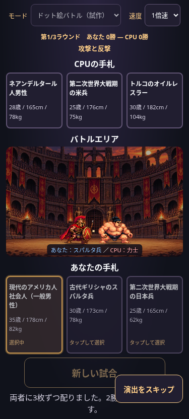
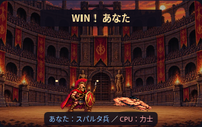

# 横視点ドット絵バトル

表示サイズは[1.35倍・高さ20%増の調整](side-view-size.md)を適用しています。

「ドット絵バトル（試作）」の戦闘演出を横視点に変更しました。カード選択と先攻後攻は共通で、両者がそろって勝敗・ストーリーが確定してから再生します。

## 背景と配置

添付の1188.jpg（実ファイルはJPEG、1280×720px）をWebP品質82で `assets/backgrounds/colosseum_side.webp` に保存しました。177,759→170,548バイト（約167KiB）で、元の構図と解像度を保持しています。

`.battle-arena.pixel-active` のときだけ新背景を指定し、中央の門が見えるcover・中央配置・32%の暗幕を適用します。元の `colosseum.webp` とカードモードの暗幕は維持しています。横視点のCSS変数は独立しており、タイトル背景には適用しません。

Canvasは320×240。あなたは左のスパルタ兵、CPUは右の力士です。足元は `GROUND_Y=212` に固定し、影も同じ地面に置きます。画像の描画高さはSPRITES設定の56/52にLAYOUT.spriteScale=1.35を掛けています。CPUを左右反転し、平滑化を無効にしています。拡縮・傾き・崩れる動作は足元を基点に行い、地面の基準と描画変形を分離しています。

## 10秒の進行

| 秒 | 演出 |
| --- | --- |
| 0〜1 | 画面の左右端から中央寄りへ入場 |
| 1〜3 | 足踏みしながら接近 |
| 3〜7 | 交互の前進・攻撃・被弾・ノックバック、短いヒット光 |
| 7〜8 | 保存済みの勝者が最後の攻撃 |
| 8〜9 | 敗者が地面に低く崩れ、勝者は立ったまま残る |
| 9〜10 | 勝者のWIN表示、その後に既存リザルト |

カメラは固定です。背景のスクロール・画面揺れ・ズームは追加していません。1倍約10秒・2倍約5秒、途中変更、スキップ、非表示時の終了、reduced-motionは既存の時間制御を再利用しています。カード配置・画像読み込みの時間は戦闘10秒に含みません。

描画モジュールは渡されたwinnerだけで最後の攻撃側を選びます。ゲーム進行、CPU選択、勝率・勝敗、30人データ、乱数、ストーリーには変更を加えていません。

## 検証

- 単体テスト：両勝者の2002時点、地面の一致、左右維持、画像四隅、攻撃距離、ノックバック、各段階の境界時刻、乱数ゼロ、速度・途中変更・スキップ・期限。
- pixel.browser.cjs：375/390/430/1280pxで両先攻・最大3ラウンド・1/2倍速・途中変更・スキップ・結果と勝者一致。両モードのカード・勝率・勝敗・文章・乱数回数の一致。
- side-view.browser.cjs：同じ4幅で俯瞰/横視点の背景切替、実画像デコード、地面と左右配置、入場からWINまでの描画を検証。
- 既存カードモード、背景、ゲームロジック、文章、CSVのテストも実行。

以下の画像はサイズ調整前の記録です。最新の比較は上記リンクを参照してください。

[PC表示](screenshots/side-view-1280.png)

## 既知の制限

待機PNGの固定配役による演出です。実際の選択キャラクターごとの画像・技、当たり判定や物理シミュレーションはありません。攻撃は前進・傾き・軽い伸縮とヒット光で表現します。

ブラウザ検証はChromiumで実ファイルをインライン化しています。実機Safariと公開GitHub Pages配信は未確認です。製品は相対パスで画像を読み込みます。
