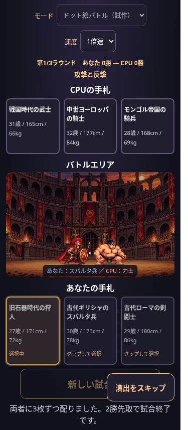
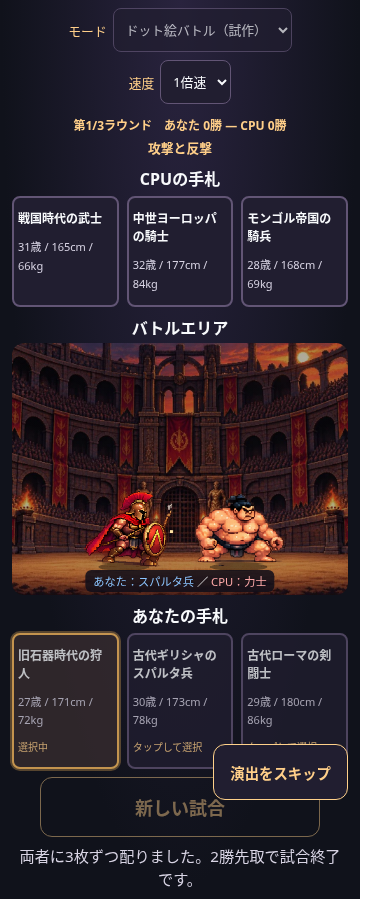

# 横視点バトルの表示サイズ調整

## 変更

- `LAYOUT.spriteScale=1.35` で両者を同倍率に拡大。基礎サイズ56/52は保持し、実描画高さは75.6/70.2（Canvas座標）です。体格差・画像の縦横比・ピクセル描画を維持しています。
- 戦闘表示の縦横比を8:5→4:3にして、高さを20%増加。Canvasも320×200→320×240にして、縦だけの引き伸ばしを防止しました。PCも同じ比率です。
- 共通の足元を212に移し、砂地にそろえました。背景画像・中央配置・暗幕は従来のままです。
- 表示専用の `projectActor` が左右に各18の間隔を追加し、画面端に8の余白を確保します。元の移動軌道や攻撃順・段階の時刻は変更していません。

## 調整場所

`js/pixel-battle.js` の `LAYOUT` に拡大率・左右間隔・画面端余白をまとめています。画像の足元・変形・影は同じ投影済み座標を使います。さらに拡大する場合は、左右間隔と全時点の見切れ・重なりテストも確認してください。

拡張は `.pixel-active` の戦闘表示時と結果表示時だけです。次のカードを選ぶときは既存のコンパクトなカード配置へ戻ります。CPU手札・プレイヤー手札は常に各3枚です。ラウンド表示・先攻後攻案内・カードモードは変更していません。

## 確認結果

- 375/390/430/1280pxで両モード・両先攻・3ラウンド・速度変更・スキップを確認。
- 同一の手札を配った変更前後で、選択前のCPU手札・中央領域・プレイヤー手札の位置と寸法が全4幅で完全一致。カードを選ぶためのスクロール量は増えていません。
- 両勝者の全2002時点で、攻撃時の傾き・伸縮や敗北時の変形を含む画像四隅が収まり、画像間に2px以上の間隔が残ることを検証。
- 変更前後のsampleSceneを全2002時点で比較し、地面のY座標以外の移動軌道・ポーズ・攻撃順・時刻・勝者が完全一致。
- 既存の勝率・勝敗・文章・30人CSVのテストが成功。ゲーム進行・文章生成・画像ファイルに差分なし。

ブラウザ検証はChromiumで実ファイルをインライン化しています。実機Safari・公開GitHub Pages配信は未確認です。

## スマホ比較（375px、同じ手札・攻防中）

変更前：

変更後：

