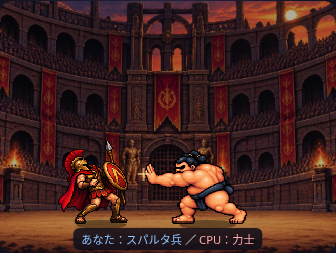
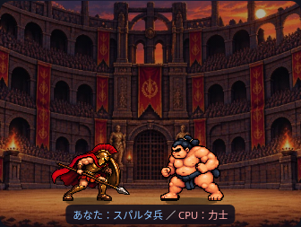

# スパルタ兵の被弾4コマ

## 使用画像と前処理

添付1207.png（2172×724px、RGBA）を人物ごとに分離し、`assets/characters/spartan_hit_4f.png` に保存しました。透明部分はアルファ値で判定し、黒色の輪郭を背景色として削除していません。

生成シートは2560×544px（640×544px×4）。元の各人物の足元は(275,633)、(870,633)、(1350,630)、(1906,633)で、共通の(320,516)へ移動しています。各人物の連結領域と周囲2px内の元ピクセルを使い、靴底より下の薄いピクセルは足元基準に含めません。色・絵柄は再生成/再描画していません。

`python scripts/prepare_spartan_hit.py 1207.png` で再現できます。Pillow/NumPy/SciPyは開発用の素材処理だけに使用し、ゲーム実行時の依存は増えません。

## 再生タイミング

既存の `damage` 状態に、400msの単発クリップを追加しました。共通のonce再生が `timeField:hitTime` を読んで100msずつ4コマを表示します。張り手の3コマ目開始（演出中の4.450秒、6.450秒、CPUが最後に攻撃する場合7.450秒）で開始します。ヒット光のフェード開始も同じ時刻です。

例：4.450〜4.850秒に構え→のけぞり→姿勢崩れ→立て直しを再生し、待機へ復帰。その後、5.200秒から既存の槍突きを再開できます。2倍速では実時間約200ms。スキップ時は既存の保存結果へ進みます。

力士の攻撃・ヒット光・移動軌道は変更していません。既存のノックバックに、被弾クリップだけ相手から離れる方向の最大3 Canvas pxの補正を加えています。これは演出上の補正で、勝敗や使用済みカードには関与しません。

## サイズと向き

基準高さ467で全4コマを同じ倍率 `56×1.35÷467` にし、姿勢で変わる画像の幅や高さを個別に引き伸ばしません。足元は共通地面212に固定し、既存の影を維持。素材ののけぞりに既存の傾きを重ねません。

元画像は右向きです。既存のspriteOrientation/drawOrientedImageを使用し、右側配置では左向きに反転。後退・被弾・待機復帰で向きは変わりません。歩行・槍突きとは排他的に表示します。

被弾は敗北ではありません。敗北/転倒へ進むのは既存の決着段階だけで、勝敗は保存された結果のままです。

## テストと制限

- hit-reaction.browser.cjs：375/390/430/1280pxで実PNGの4コマ順、左右/1倍2倍、靴底・固定倍率、槍/盾/マントの画面内、ヒット開始、待機/攻撃復帰を検証。
- pixel-battle：単発400ms、順序、反転、歩行/攻撃との排他、開始同期、攻撃再開、既存の速度/スキップ。
- facing.browser：新素材も独立した元向きfixtureへ追加。全4幅の連続描画で向きの一致を確認。
- pixel/mobile：全4幅・両先攻・最大3ラウンド、速度/途中変更/スキップ、保存結果・乱数回数一致、既存カードモードを確認。
- 力士、歩行足元、勝敗、進行、文章、正式CSV等の既存テストも成功。

素材の構え・体つきの差は残ります。ブラウザ検証は実ファイルをインライン化したChromiumで、左右入れ替えは検証用座標を使用しています。実機Safari・公開Pagesは未確認です。
