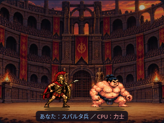
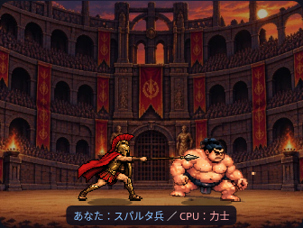

# スパルタ兵の槍突き（試験）

添付1200.png（2172×724px）から人物ごとの連結した透過領域を分離し、`assets/characters/spartan_thrust_4f.png` に保存しました。元画像は3コマ目の槍と4コマ目のマントのX範囲が重なるため、4等分や矩形だけの切り出しは行っていません。

## シートの基準

生成シートは3328×480px（832×480px ×4コマ）。すべて足元を(240,460)へ配置し、同じ縮尺で描画します。人物の描画高さの基準は453pxで、既存の `56 × 1.35` に合わせています。各コマの幅に合わせて人物を縮めることはありません。

元画像の足元基準は順に(218,600)、(710,598)、(1268,597)、(1958,599)です。人物の連結領域とその周囲2px内にある元の透過ピクセルを使用しています。輪郭の作り直しやAIによる補完はありません。4コマ目の槍先は提供画像の右端に接しており、元絵の外側は補っていません。

## 再生と同期

`SPRITES.player.poses.attack` にパス、単発再生、500ms、4コマの矩形、足元基準・高さ基準を設定しています。共通の `spriteFrame` で歩行はループ、槍突きは単発を選択します。

既存の1秒の攻撃区間の200〜700msに4コマを125msずつ再生し、その後は待機へ戻します。3コマ目の450〜575msだけヒット光を出し、450msから力士が被弾します。槍先と力士の体が重なる位置を確認しています。槍突き中は従来の傾き・伸縮を重ねず、武器が不自然に揺れるのを防ぎます。

力士の攻撃区間・全体10秒の時間制御は維持し、1倍速・2倍速・途中変更・スキップは既存の演出時間に追従します。2倍速で槍突きは約250msです。勝率・勝敗・CPU選択・カード・文章の処理に変更はありません。

## 検証

- 単体：4コマ順、500msで終了・非ループ、待機復帰、反転、3コマ目とヒット/被弾の同期、槍先が相手の体に届く位置、足元と縦横比、既存の速度・スキップ。
- 375/390/430/1280pxで実画像4コマの収まり、歩行・待機と切り替え、両先攻・最大3ラウンド、1/2倍速、結果・物語・乱数消費の一致を確認。
- カードモードと既存の勝敗・進行・文章・CSVのテストを実行。

素材の違いによる体つき・構えの差は残ります。ブラウザ検証は実ファイルをインライン化したChromiumです。実機Safari・公開GitHub Pages配信は未確認です。
