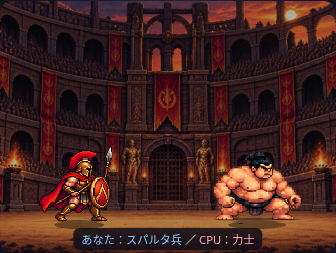
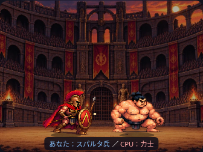

# スパルタ兵の4コマ歩行（試験）

歩行の足元と倍率は[上下ガタつき修正](stable-walk.md)で更新しました。以下は初期導入の記録です。

添付の1198.pngを `assets/characters/spartan_walk_4f.png` にそのまま保存しました。768×192pxの透過PNG、192×192pxの4コマです。

## 再生と調整

`js/pixel-battle.js` の `SPRITES.player.poses.walk` に画像パス・fps:7・4つの描画矩形を設定しています。既存の1倍速では7コマ/秒、2倍速では演出時間が2倍に進むため14コマ/実秒です。画像は左から右へ順にループします。

各コマの透過余白を除いた矩形を使い、下辺中央を共通の足元へ合わせています。高さは既存の `56 × LAYOUT.spriteScale` を維持し、幅は縦横比に合わせます。追加の上下揺れは歩行シートに加えません。

`spriteFrame` は側・姿勢・移動有無・移動方向・経過時間から画像とコマを選びます。入場/接近中も、表示位置が画面端で止まっている間は待機画像を使用します。停止・攻撃・被弾・決着では既存の待機画像を使います。歩行中の逆方向は移動方向で反転できます。現在の入場/接近はスパルタ兵が右へ進む構成です。

他のキャラクターにも `poses.walk={src, fps, frames}` を追加できます。読み込み処理は設定された全画像を待ち、シートが読み込めなければ待機画像に戻ります。コマ選択や描画は乱数を使わず、勝敗・進行・ストーリーを参照して再判定する処理もありません。

## 検証

- 単体：4コマ順序・ループ、移動停止/姿勢変更時の待機、逆方向反転、力士の既存表示、歩行全コマの見切れ、縦横比・足元、既存の1/2倍速と途中変更。
- Chromium：375/390/430/1280pxで実PNGの4コマ・停止復帰、両先攻・3ラウンド、速度変更・スキップ・非表示時の終了を確認。
- 両モードの同じ乱数列で、カード・勝率・勝敗・ストーリー・乱数消費回数が一致。
- カードモード、背景、勝敗・進行・ストーリー・正式CSV等の既存テストも実行。

ネットワーク制限のため、ブラウザ検証では実画像をインライン化しています。製品は相対パスで読み込みます。実機Safari・公開GitHub Pages配信は未確認です。

## 表示と制限

歩行中：

待機へ復帰：

足元・描画高さはそろえていますが、素材由来の胴体の太さ・構えの差は残ります。攻撃や被弾は引き続き待機PNGによる簡易表現です。新しい素材は生成していません。
