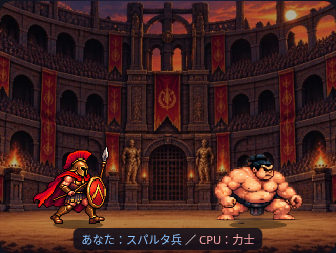
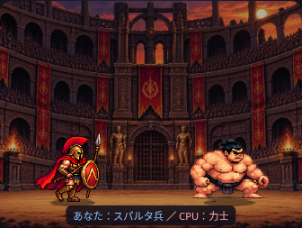

# 歩行の上下ガタつき修正

## 原因：画像側と描画側の両方

歩行シートの3・4コマ目には、靴より下にごく薄い透過ピクセルがありました。従来はそれを含めて矩形の下端を足元としたため、実際の靴が浮いていました。また、コマごとに異なる切り出し高さを同じ表示高さにしていたので、人物の描画倍率が変動していました。

| コマ | 旧矩形の下端（セル内Y） | 靴底（alpha>32） | 旧表示での靴底の浮き |
| --- | --- | --- | --- |
| 1 | 179 | 176 | 約1.6px |
| 2 | 180 | 177 | 約1.6px |
| 3 | 180 | 159 | 約9.6px |
| 4 | 177 | 160 | 約8.0px |

ピクセル値はCanvas座標です。画面への拡大で目立ちやすくなります。加えて、画面端で移動していない間に待機画像へ戻ると、以前の仮歩行用の2%伸縮が残っていました。

## 修正

PNGは編集せず、描画矩形の下端を靴底に合わせ、4コマ共通の `referenceHeight:144` による倍率へ変更しました。コマ別の足の中央位置と下端を `anchors` に定義し、地面の212にそろえています。歩行シートのあるキャラには、旧仮歩行の伸縮を加えません。

表示上のコマ高さは約74.6〜76.1（旧75.6）で、サイズ感は維持しています。7fps・コマ順・足元の地面・左右移動・攻撃設定・1/2倍速・スキップは変更していません。素材の構えや膝の曲がり方そのものによる動きは残しています。

## 検証

- 375/390/430/1280pxで実PNGを読み、4コマの靴底と足元基準が一致することを確認。
- 実CanvasのdrawImageと変換行列を検査し、4コマの倍率が一定、歩行/停止中に不要な上下移動・伸縮がないことを確認（walk-footing.browser.cjs）。
- 同じ4幅で歩行4コマ・待機・槍突きへの切替を目視確認。
- 既存のpixel/mobileテストで両先攻・3ラウンド・速度・保存結果と乱数一致を確認。勝敗・文章・CSVのテストも成功。
- 攻撃シート、ゲーム進行、背景、PNG、UIの表示文言は変更なし（スクリプトのキャッシュ用バージョンのみ更新）。

確認環境はChromiumです。ネットワーク制限のためテスト時のみ実画像をインライン化しています。実機Safariと公開GitHub Pages配信は未確認です。
