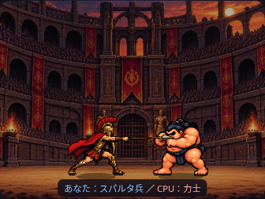
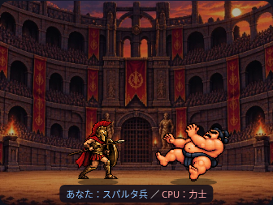

# 相撲力士の被弾4コマ

## 保存先と素材処理

今回添付された1208.png（2172×724px、透過RGBA）を `assets/characters/sumo_hit_4f.png` に整理しました。比較用には既存リポジトリのsumo_walk_4f.png・sumo_slap_4f.pngを使用しています。

人物を個別に分離し、768×544pxの透明キャンバス4枚（シート3072×544px）へ配置しました。元の足元(251,648)、(757,648)、(1364,642)、(1917,648)を共通(320,516)へ合わせています。色や黒い輪郭は描き直さず、アルファで人物を判別。靴底より下の薄いピクセルは足元基準に含めません。

再現用スクリプト：`python scripts/prepare_sumo_hit.py 1208.png`。開発用の前処理のみPillow/NumPy/SciPyを使用し、ゲーム実行時のライブラリ依存はありません。

## 実装

既存のdamageクリップとtimeField:hitTimeを使用し、400msで4コマを100msずつ単発再生します。槍突きのヒット開始（3.450秒、5.450秒、最後にあなたが攻撃する場合7.450秒）で開始し、終了後は既存の待機・後退歩行・張り手へ戻ります。2倍速では実時間約200msです。被弾中に歩行や攻撃は重ねません。

倍率は全コマ共通の `52×1.35÷466`。靴底・影の地面は212のままで、スパルタ兵の被弾と同じ最大3pxの演出上のノックバックを使用します。追加のY移動・伸縮・傾きを加えません。素材そのものに描かれた脚を持ち上げる姿勢は保持しています。

被弾画像は元から右向きなのでsourceFacing=1を指定。既存の共通描画で右配置なら左を向き、idle/walk/attack/damage切替や後退で背を向きません。待機素材の元向き（左）と混同しないよう、独立した向きfixtureにも追加しました。

被弾は敗北ではなく、回復後に張り手を再開できます。勝敗判定・ゲーム進行・30人データ・乱数・文章、既存の歩行/攻撃/待機素材、背景、UIレイアウトは変更していません。HTMLはキャッシュバージョンのみ更新しています。

## テスト

- 375/390/430/1280px：sumo-hit.browser.cjsで実PNGの4コマ順、左右配置・1/2倍速、靴底・定倍率・画面内、ヒット開始と待機/張り手復帰を確認。
- pixel/facing：両先攻・最大3ラウンド・速度変更・スキップ、全素材の連続描画方向、保存済み結果・物語・乱数回数一致を確認。
- mobile：全4幅のカードモードと375/1280pxのreduced-motionを確認。
- 両者の被弾、力士の歩行/張り手、スパルタ兵の足元、勝敗/進行/文章/CSV等の既存テストも成功。
- スマホとPCで4コマ・回復後を目視確認。体つきや構えの違いは素材のまま残ります。

確認は実ファイルをインライン化したChromiumです。左右入れ替えは検証用座標を使用しています。実機Safari・公開Pagesは未確認です。
