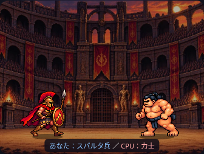
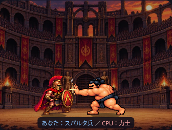

# 力士の歩行・張り手

最新の画像登録設定は [ID別スプライト登録表](sprite-registry.md) を参照してください。以下の固定配役・設定位置は当時の実装記録です。

## 変更ファイル

- `assets/characters/sumo_walk_4f.png`：歩行4コマ（1280×336px、320×336px×4）
- `assets/characters/sumo_slap_4f.png`：張り手4コマ（2816×496px、704×496px×4）
- `js/pixel-battle.js`：力士の設定・攻撃同期・演出上の踏み込み
- `index.html`：スクリプトのキャッシュバージョンのみ更新
- `scripts/prepare_sumo_sheets.py`：素材処理の再現用スクリプト
- テスト・本資料・確認画像

## 素材の前処理

歩行素材1204.jpgは1280×427pxのJPEGで、チェッカーが焼き込まれていました。背景の無彩色領域を判別し、4人の人物の主要な連結領域を残して透明化しました。人物の閉じた内部は元のRGBを保持しています。髷・顔・まわし・肌の描き直し、色変換、AI生成は行っていません。透明領域のRGBもゼロにしています。

張り手1205.pngは2172×724pxの透過PNGでした。4コマを人物ごとに分離し、同じ透明キャンバスに配置。靴底より下の薄いピクセルを足元の基準に使わないよう除外しました。どちらも素材の画素を移動する処理で、再拡縮はしていません。

再現コマンド：

```sh
python scripts/prepare_sumo_sheets.py 1204.jpg 1205.png
```

この開発用スクリプトのみPillow・NumPy・SciPyを使用します。ゲームは引き続きHTML/CSS/JavaScriptと画像だけで動き、外部ライブラリ・サーバーは不要です。

## 共通再生処理

既存の `spriteFrame` を再利用し、力士の `poses.walk` と `poses.attack` を追加しました。歩行は6fps、表示上の移動方向で反転します。移動していないときはidle、攻撃中は歩行を重ねず、攻撃後の後退中は歩行へつなぎます。移動軌道は維持しています。

張り手は500msの単発再生です。既存の攻撃区間の200〜700msで4コマを125msずつ表示し、3コマ目の450〜575msにヒット光、450msから相手の被弾を合わせます。力士だけ、攻撃中の表示位置を最大8 Canvas px前へ補います。勝敗やCPUのカード選択には関係しません。

歩行の基準高さ300・足元(160,316)、張り手の基準高さ458・足元(256,476)を設定し、既存の `52×1.35` の体格を基準に一定倍率で描画します。影・バトル領域の高さ・背景は維持しています。素材に描かれた待機時のしゃがみと、歩行時の立ち姿には違いが残ります。

スパルタ兵の素材と歩行・槍突き設定は変更していません。張り手を受ける被弾タイミングだけを新しい3コマ目へ同期しています。

## テスト

- `sumo.browser.cjs`：375/390/430/1280pxで実PNGの透過・全コマの靴底・歩行4コマ/張り手順序・画像の収まり・ヒット同期・攻撃終了を検証。
- `pixel-battle.test.cjs`：歩行ループ・停止・前進/後退の反転・張り手単発・同期・後退からの歩行復帰、既存スパルタ兵のテスト。
- `pixel.browser.cjs`：全4幅、両先攻・最大3ラウンド・1/2倍速・途中変更・スキップ・結果保存・両モードの乱数回数一致。
- `mobile.browser.cjs`：全4幅のカードモード。375/1280pxのreduced-motionも確認。
- `walk-footing.browser.cjs`：スパルタ兵の靴底と倍率の安定。
- 既存の勝敗・進行・ストーリー・30人CSVテストも成功。

ブラウザ確認は実ファイルをインライン化したChromiumです。実機Safari・公開GitHub Pages配信は未確認です。




